# WR-MovementIQ: Competition Research Report

## Beyond the 40-Yard Dash: Linking NFL Combine Receiver Movement Mechanics to Regular-Season Performance Using Player Tracking Data

**Project:** WR-MovementIQ  
**Competition:** NFL Big Data Bowl 2027  
**Report status:** Evidence-based research draft  
**Generated:** 2026-11-19 02:15 UTC

---

# Abstract

This study investigates the extent to which movement characteristics measured during NFL Combine receiver-specific drills are associated with regular-season in-game movement performance among wide receivers.

The research combines traditional Combine measurements with tracking-derived movement characteristics from Combine drills and NFL regular-season player tracking. Game movement outcomes include mean speed, peak speed, 95th-percentile speed, acceleration summaries and path efficiency.

The primary modeling dataset contains 93 player-season observations from 54 receivers. Four model specifications are compared: an intercept-only baseline, traditional Combine predictors, tracking-derived Combine predictors and a combined predictor set. Predictive evaluation uses receiver-grouped nested cross-validation, with a separate leave-one-draft-cohort-out analysis. Receiver-level bootstrap procedures quantify uncertainty in selected comparisons.

The results show that traditional Combine measurements, particularly the 40-yard dash, have meaningful marginal associations with in-game speed. Tracking-derived Combine movement features also show modest associations with selected in-game speed outcomes. However, the evidence does not establish a consistent, statistically convincing improvement in absolute predictive accuracy from adding tracking-derived features. Some combined models have favourable point estimates for high-speed outcomes, but the receiver-level bootstrap confidence intervals include zero.

The findings support further investigation of receiver movement mechanics while highlighting sample-size constraints, predictor collinearity, cohort differences and the distinction between association and prediction.

**Keywords:** NFL, wide receivers, player tracking, NFL Combine, movement mechanics, Ridge regression, nested cross-validation, receiver analytics.

---

# 1. Introduction

The NFL Combine provides standardized measurements of athletic performance. Traditional tests such as the 40-yard dash, vertical jump and broad jump are widely used to characterize athletic attributes. These tests, however, capture only selected dimensions of movement performance.

Receiver-specific Combine drills provide a richer opportunity to examine movement mechanics. Tracking data can describe speed, acceleration, directional changes and path characteristics during structured drills. NFL player tracking data also provide observations of movement during regular-season play.

This project investigates whether Combine movement characteristics correspond to measurable in-game movement performance.

The study does not assume that a Combine drill reproduces the demands of an NFL play. Instead, it tests whether structured athletic measurements contain information associated with selected game movement summaries.

## 1.1 Research problem

Traditional Combine metrics are convenient and standardized, but they may not fully characterize the multidimensional movement demands of NFL receiving.

The central empirical problem is whether tracking-derived Combine features provide useful information beyond traditional Combine measurements.

## 1.2 Research question

To what extent do movement characteristics measured during NFL Combine receiver-specific drills explain variation in wide receivers' in-game movement characteristics during regular-season NFL plays?

## 1.3 Research objectives

1. Construct receiver-level and player-season movement features from Combine and NFL tracking data.
2. Quantify associations between Combine movement characteristics and in-game movement outcomes.
3. Compare traditional, tracking-derived and combined predictor specifications.
4. Evaluate performance using receiver-grouped nested cross-validation.
5. Examine cohort-specific performance using leave-one-draft-cohort-out validation.
6. Assess uncertainty, feature sensitivity and coefficient stability.

## 1.4 Research hypotheses

- **H1:** Traditional Combine measurements are associated with selected in-game movement outcomes.
- **H2:** Tracking-derived Combine movement features are associated with selected in-game movement outcomes.
- **H3:** Combining traditional and tracking-derived features may improve prediction relative to traditional measurements alone.
- **H4:** The magnitude and consistency of predictive performance vary across held-out draft cohorts.

These are empirical hypotheses. The analysis does not presume that any will be supported.

---

# 2. Data and provenance

## 2.1 Data sources

The project uses the following data files supplied within the competition research environment:

- `combine_results.csv`
- `combine_tracking.csv`
- `game_tracking_2023.csv`
- `game_tracking_2024.csv`
- `game_tracking_2025.csv`
- `player_play.csv`
- `players.csv`
- `games.csv`
- `player_career_successes.csv`

The files serve different roles in the pipeline, including Combine measurements, Combine drill tracking, NFL game tracking, player/play metadata, player identity and draft information.

The analysis uses player identifiers to connect Combine and game records. Data provenance and intermediate audit outputs are maintained in the project.

## 2.2 Population

The analytical population is focused on wide receivers, including the WR and SLOT_WR categories where specified by the pipeline.

The project does not assume that results for wide receivers generalize to other positions.

## 2.3 Research unit

The primary modeling unit is the player-season.

Multiple player-season observations can belong to the same receiver. Therefore, validation groups observations by receiver to reduce information leakage between training and test folds.

## 2.4 Eligibility

The core sample applies the project-defined receiver-play eligibility requirement and complete-case predictor/outcome requirements.

The primary frozen sample contains:

- **93 player-season observations**
- **54 unique receivers**
- **5 outer validation folds**

No imputation was introduced to force incomplete records into the core modeling sample.

The threshold sensitivity analysis is retained as a separate robustness assessment.

### Eligibility sample sensitivity

| threshold | player_seasons | unique_receivers |
| --- | --- | --- |
| 5 | 93 | 54 |
| 8 | 93 | 54 |
| 10 | 93 | 54 |
| 12 | 92 | 53 |
| 15 | 83 | 48 |

---

# 3. Feature engineering

## 3.1 Traditional Combine predictors

The traditional predictor specification uses:

- 40-yard dash time (`forty`)
- Vertical jump (`vertical`)
- Broad jump (`broad_jump`)

These measurements provide standardized athletic benchmarks.

## 3.2 Tracking-derived Combine predictors

The tracking specification uses summaries of Combine drill movement:

- Mean speed
- Peak speed
- 95th-percentile speed
- Mean acceleration
- Peak acceleration
- Path efficiency

The project constructs attempt-level features before aggregating information across drills and player profiles.

Tracking-derived variables are treated according to their validated data definitions. Acceleration magnitude is not automatically interpreted as signed braking or deceleration.

## 3.3 Game movement outcomes

The primary outcomes are:

- Mean game speed
- Peak game speed
- 95th-percentile game speed
- Mean game acceleration
- Peak game acceleration
- Game path efficiency

The outcomes summarize in-game tracking observations at the player-season level.

They are movement descriptors, not direct measures of receiving skill, route-running quality or overall player value.

---

# 4. Modeling methodology

## 4.1 Model specifications

Four specifications are compared.

| Model | Predictors |
|---|---|
| Baseline | Intercept-only reference |
| Traditional | 40-yard dash, vertical jump, broad jump |
| Tracking | Combine tracking-derived movement features |
| Combined | Traditional and tracking-derived predictors |

## 4.2 Ridge regression

Ridge regression is used to estimate predictive relationships while regularizing coefficients.

Predictors are standardized within a modeling pipeline. Hyperparameter selection is conducted using training data only.

The alpha search grid is:

`[0.001, 0.01, 0.1, 1, 10, 100, 1000, 10000, 100000]`

The selected regularization strength is determined by inner validation MAE.

## 4.3 Nested cross-validation

The primary evaluation uses five outer GroupKFold folds grouped by receiver identifier.

Inner validation is also grouped by receiver. Hyperparameter selection occurs within the outer training data.

This design is intended to prevent observations from the same receiver from appearing in both the training and test portions of a fold.

The reported out-of-fold metrics are predictive estimates under this validation design. They are not in-sample fit statistics.

## 4.4 Leave-one-draft-cohort-out validation

The LOCO analysis withholds one draft cohort at a time.

The available held-out cohorts are 2023, 2024 and 2025. Their test sample sizes differ, so cohort-specific estimates have different levels of precision.

## 4.5 Evaluation metrics

- **MAE:** Average absolute prediction error.
- **RMSE:** Square-root average squared prediction error, more sensitive to large errors.
- **R²:** Performance relative to the test-set mean reference.
- **Spearman correlation:** Rank association between predicted and observed values where reported.

The receiver-level bootstrap provides uncertainty estimates for paired model comparisons. The bootstrap estimand is not interchangeable with the pooled player-season OOF metric.

---

# 5. Results

## 5.1 Nested cross-validation performance

The following table reports the primary nested-CV results.

| outcome_label | model | n | mae | rmse | r2 | spearman |
| --- | --- | --- | --- | --- | --- | --- |
| Game path efficiency | BASELINE | 93 | 0.0079 | 0.0107 | -0.0702 | -0.3107 |
| Game path efficiency | COMBINED | 93 | 0.0082 | 0.0112 | -0.1651 | -0.2233 |
| Game path efficiency | TRACKING | 93 | 0.0083 | 0.0112 | -0.1783 | -0.1578 |
| Game path efficiency | TRADITIONAL | 93 | 0.0081 | 0.0108 | -0.0971 | -0.3649 |
| Mean game acceleration | BASELINE | 93 | 0.1445 | 0.1838 | -0.0337 | -0.2323 |
| Mean game acceleration | COMBINED | 93 | 0.1522 | 0.1931 | -0.1409 | -0.2061 |
| Mean game acceleration | TRACKING | 93 | 0.1517 | 0.1921 | -0.1294 | -0.2757 |
| Mean game acceleration | TRADITIONAL | 93 | 0.1480 | 0.1882 | -0.0839 | -0.1430 |
| Mean game speed | BASELINE | 93 | 0.3880 | 0.5096 | -0.0649 | -0.3313 |
| Mean game speed | COMBINED | 93 | 0.3951 | 0.5165 | -0.0941 | -0.1649 |
| Mean game speed | TRACKING | 93 | 0.4055 | 0.5272 | -0.1400 | -0.2236 |
| Mean game speed | TRADITIONAL | 93 | 0.3955 | 0.5127 | -0.0781 | -0.1006 |
| P95 game speed | BASELINE | 93 | 0.4752 | 0.6493 | -0.1111 | -0.3252 |
| P95 game speed | COMBINED | 93 | 0.4517 | 0.5982 | 0.0570 | 0.3413 |
| P95 game speed | TRACKING | 93 | 0.4869 | 0.6560 | -0.1339 | -0.1082 |
| P95 game speed | TRADITIONAL | 93 | 0.4722 | 0.6197 | -0.0119 | 0.2463 |
| Peak game acceleration | BASELINE | 93 | 0.3007 | 0.3894 | -0.0375 | -0.1640 |
| Peak game acceleration | COMBINED | 93 | 0.3022 | 0.3852 | -0.0152 | -0.1786 |
| Peak game acceleration | TRACKING | 93 | 0.3024 | 0.3874 | -0.0267 | -0.2626 |
| Peak game acceleration | TRADITIONAL | 93 | 0.3044 | 0.3849 | -0.0138 | -0.0337 |
| Peak game speed | BASELINE | 93 | 0.4670 | 0.6369 | -0.1044 | -0.3020 |
| Peak game speed | COMBINED | 93 | 0.4370 | 0.5765 | 0.0951 | 0.3773 |
| Peak game speed | TRACKING | 93 | 0.4808 | 0.6400 | -0.1150 | -0.1062 |
| Peak game speed | TRADITIONAL | 93 | 0.4714 | 0.6188 | -0.0424 | 0.1960 |

The baseline is an important reference. A more complex specification should not be considered useful merely because it produces a fitted relationship. It must demonstrate improved out-of-fold predictive performance.

Results differ across movement outcomes. The combined model has favourable point estimates for some high-speed outcomes, but does not consistently improve performance across all outcomes.

## 5.2 Primary speed-outcome uncertainty

The receiver-level bootstrap compares each evaluated model against the baseline. Negative MAE differences favour the evaluated model.

| outcome_label | model | point_estimate | ci_2_5 | ci_97_5 | probability_difference_below_zero | folds_model_better | folds_model_worse | receivers |
| --- | --- | --- | --- | --- | --- | --- | --- | --- |
| P95 game speed | TRADITIONAL | 0.0126 | -0.0346 | 0.0605 | 0.2980 | 1 | 4 | 54 |
| P95 game speed | TRACKING | 0.0189 | -0.0150 | 0.0550 | 0.1336 | 1 | 4 | 54 |
| P95 game speed | COMBINED | -0.0075 | -0.0678 | 0.0544 | 0.5966 | 2 | 3 | 54 |
| Peak game speed | TRADITIONAL | 0.0208 | -0.0250 | 0.0677 | 0.1886 | 1 | 4 | 54 |
| Peak game speed | TRACKING | 0.0192 | -0.0167 | 0.0555 | 0.1494 | 1 | 4 | 54 |
| Peak game speed | COMBINED | -0.0103 | -0.0774 | 0.0552 | 0.6302 | 2 | 3 | 54 |

For the 95th-percentile and peak-speed outcomes, the combined specification has favourable point estimates in the reported receiver-level comparisons. However, the confidence intervals include zero.

Consequently, the results do not establish a reliable improvement in absolute predictive accuracy.

## 5.3 Draft-cohort generalization

| outcome_label | held_out_draft_year | model | n | mae | rmse | r2 |
| --- | --- | --- | --- | --- | --- | --- |
| Mean game speed | 2023 | BASELINE | 45 | 0.4061 | 0.5284 | -0.0130 |
| Mean game speed | 2023 | COMBINED | 45 | 0.4311 | 0.5502 | -0.0983 |
| Mean game speed | 2023 | TRACKING | 45 | 0.4310 | 0.5502 | -0.0983 |
| Mean game speed | 2023 | TRADITIONAL | 45 | 0.4311 | 0.5502 | -0.0984 |
| Mean game speed | 2024 | BASELINE | 34 | 0.3642 | 0.4998 | -0.1756 |
| Mean game speed | 2024 | COMBINED | 34 | 0.3572 | 0.4806 | -0.0870 |
| Mean game speed | 2024 | TRACKING | 34 | 0.3620 | 0.4939 | -0.1480 |
| Mean game speed | 2024 | TRADITIONAL | 34 | 0.3638 | 0.4900 | -0.1296 |
| Mean game speed | 2025 | BASELINE | 14 | 0.3273 | 0.4088 | -0.0207 |
| Mean game speed | 2025 | COMBINED | 14 | 0.3908 | 0.4930 | -0.4847 |
| Mean game speed | 2025 | TRACKING | 14 | 0.3664 | 0.4659 | -0.3260 |
| Mean game speed | 2025 | TRADITIONAL | 14 | 0.3257 | 0.4046 | 0.0001 |
| P95 game speed | 2023 | BASELINE | 45 | 0.4519 | 0.6494 | -0.0003 |
| P95 game speed | 2023 | COMBINED | 45 | 0.4565 | 0.6475 | 0.0057 |
| P95 game speed | 2023 | TRACKING | 45 | 0.4629 | 0.6532 | -0.0120 |
| P95 game speed | 2023 | TRADITIONAL | 45 | 0.4588 | 0.6493 | 0.0001 |
| P95 game speed | 2024 | BASELINE | 34 | 0.5076 | 0.6623 | -0.1905 |
| P95 game speed | 2024 | COMBINED | 34 | 0.4655 | 0.5675 | 0.1259 |
| P95 game speed | 2024 | TRACKING | 34 | 0.4863 | 0.6278 | -0.0695 |
| P95 game speed | 2024 | TRADITIONAL | 34 | 0.4788 | 0.6029 | 0.0136 |
| P95 game speed | 2025 | BASELINE | 14 | 0.3744 | 0.4729 | -0.0093 |
| P95 game speed | 2025 | COMBINED | 14 | 0.3200 | 0.3850 | 0.3311 |
| P95 game speed | 2025 | TRACKING | 14 | 0.3885 | 0.4879 | -0.0743 |
| P95 game speed | 2025 | TRADITIONAL | 14 | 0.3382 | 0.4180 | 0.2114 |
| Peak game speed | 2023 | BASELINE | 45 | 0.4530 | 0.6367 | -0.0002 |
| Peak game speed | 2023 | COMBINED | 45 | 0.4672 | 0.6426 | -0.0188 |
| Peak game speed | 2023 | TRACKING | 45 | 0.4672 | 0.6426 | -0.0189 |
| Peak game speed | 2023 | TRADITIONAL | 45 | 0.4672 | 0.6426 | -0.0188 |
| Peak game speed | 2024 | BASELINE | 34 | 0.4960 | 0.6658 | -0.2108 |
| Peak game speed | 2024 | COMBINED | 34 | 0.4715 | 0.5793 | 0.0834 |
| Peak game speed | 2024 | TRACKING | 34 | 0.4750 | 0.6297 | -0.0830 |
| Peak game speed | 2024 | TRADITIONAL | 34 | 0.5044 | 0.6110 | -0.0198 |
| Peak game speed | 2025 | BASELINE | 14 | 0.3675 | 0.4424 | -0.0139 |
| Peak game speed | 2025 | COMBINED | 14 | 0.2895 | 0.3533 | 0.3534 |
| Peak game speed | 2025 | TRACKING | 14 | 0.3716 | 0.4582 | -0.0876 |
| Peak game speed | 2025 | TRADITIONAL | 14 | 0.3891 | 0.4512 | -0.0549 |

The LOCO results vary across cohorts and outcomes. The 2025 held-out cohort contains fewer test player-seasons than the earlier cohorts. Its estimates should therefore be interpreted cautiously.

The available evidence does not justify a claim of robust generalization to unseen future draft cohorts.

## 5.4 Univariate predictor associations

The strongest marginal associations include:

| outcome_label | predictor | group | n | spearman_rho |
| --- | --- | --- | --- | --- |
| Peak game speed | forty | TRADITIONAL | 93 | -0.3662 |
| P95 game speed | forty | TRADITIONAL | 93 | -0.3547 |
| P95 game speed | combine_peak_speed_median_across_drills | TRACKING | 93 | 0.2927 |
| Peak game speed | combine_peak_speed_median_across_drills | TRACKING | 93 | 0.2904 |
| Mean game speed | combine_peak_speed_median_across_drills | TRACKING | 93 | 0.2704 |
| P95 game speed | combine_p95_speed_median_across_drills | TRACKING | 93 | 0.2651 |
| Peak game speed | combine_p95_speed_median_across_drills | TRACKING | 93 | 0.2599 |
| Game path efficiency | combine_peak_speed_median_across_drills | TRACKING | 93 | 0.2436 |
| Peak game acceleration | vertical | TRADITIONAL | 93 | -0.2432 |
| Mean game speed | combine_p95_speed_median_across_drills | TRACKING | 93 | 0.2385 |
| P95 game speed | combine_path_efficiency_median_across_drills | TRACKING | 93 | -0.2080 |
| Mean game speed | forty | TRADITIONAL | 93 | -0.1926 |
| Peak game speed | combine_path_efficiency_median_across_drills | TRACKING | 93 | -0.1920 |
| Game path efficiency | combine_p95_speed_median_across_drills | TRACKING | 93 | 0.1859 |
| Mean game acceleration | combine_p95_speed_median_across_drills | TRACKING | 93 | -0.1857 |

The 40-yard dash shows a negative association with selected in-game speed outcomes: faster dash times tend to correspond to higher game speed summaries.

Combine tracking-derived speed features also show positive marginal associations with selected in-game speed outcomes.

These are univariate relationships. They do not establish independent predictor effects after adjustment for other variables.

## 5.5 Feature ablation

Feature ablation compares full and reduced tracking-derived predictor specifications.

The results are retained in `tables/tracking_feature_ablation.csv`.

The ablation analysis does not support a simplistic conclusion that one feature is universally essential. Predictor redundancy and correlations between speed summaries complicate attribution.

In particular, Combine peak speed and Combine P95 speed are strongly correlated. Their information may overlap.

## 5.6 Stability and interpretation

Coefficient stability varies across outer folds. Strong regularization is selected for some outcomes and model specifications.

These findings indicate that the fitted coefficients should not be interpreted as stable independent effects.

The study therefore emphasizes out-of-fold prediction and uncertainty rather than assigning causal or mechanistic meaning to individual Ridge coefficients.

---

# 6. Discussion

## 6.1 Traditional athletic benchmarks retain value

The 40-yard dash has a meaningful marginal relationship with selected in-game speed summaries. This supports the continued relevance of standardized speed testing as one component of receiver athletic evaluation.

However, a speed test does not capture every aspect of receiver movement.

## 6.2 Tracking-derived Combine features contain some signal

Tracking-derived speed summaries show marginal associations with game speed outcomes. This suggests that structured drill tracking can provide additional descriptive information about receiver movement.

The results are not sufficient to establish that tracking-derived features consistently improve absolute prediction beyond traditional measurements.

## 6.3 Combined models require cautious interpretation

Some combined models have better point estimates for high-speed outcomes. Nevertheless, receiver-level bootstrap intervals include zero, and fold-level results are not uniformly favourable.

A lower point estimate alone is not enough to claim an established predictive gain.

## 6.4 Prediction is not causation

The study is observational. Combine movement measurements are not randomly assigned, and player movement is influenced by many factors that are not fully represented in this analysis.

The findings must not be interpreted as evidence that a particular Combine drill characteristic causes better NFL performance.

---

# 7. Limitations

1. **Sample size:** The core analysis contains 93 player-seasons from 54 receivers.
2. **Complete-case selection:** Requiring complete predictors and outcomes reduces the available sample.
3. **Cohort imbalance:** The LOCO test cohorts have unequal sample sizes.
4. **Predictor collinearity:** Some tracking-derived speed features are strongly correlated.
5. **Coefficient instability:** Coefficient estimates vary across validation folds.
6. **Outcome scope:** The outcomes are movement summaries, not comprehensive measures of receiver effectiveness.
7. **Observational design:** The analysis does not identify causal effects.
8. **External validity:** Findings from the available cohorts should not automatically be generalized to all NFL receivers or future seasons.
9. **Measurement interpretation:** Tracking variables must be interpreted using their documented definitions and validated transformations.

---

# 8. Scientific contribution

The contribution of WR-MovementIQ is a reproducible framework for connecting structured Combine drill tracking with regular-season player movement.

The project moves beyond a single athletic test by constructing multidimensional movement summaries and evaluating them against in-game tracking outcomes.

It also emphasizes receiver-grouped validation, cohort holdout analysis, bootstrap uncertainty and independent reconstruction audits.

The evidence suggests that tracking-derived Combine features may contain useful movement information. However, their incremental predictive value beyond traditional measurements remains uncertain in the available sample.

---

# 9. Conclusion

This study examined whether NFL Combine receiver movement characteristics are associated with regular-season in-game movement performance.

The results show that traditional Combine measurements, especially the 40-yard dash, have meaningful marginal associations with game speed. Tracking-derived Combine movement features also show modest associations with selected game speed outcomes.

However, the evidence does not establish consistent incremental predictive improvement from tracking-derived features. Combined models show some favourable point estimates for P95 and peak game speed, but receiver-level bootstrap confidence intervals include zero.

The most defensible conclusion is that Combine drill tracking provides a promising additional description of receiver movement, but its incremental predictive value requires further validation using larger samples and additional cohorts.

---

# 10. Reproducibility and audit trail

The report is generated from the validated Notebook 11 synthesis tables and Notebook 12 publication figures.

The underlying modeling and validation outputs are retained in their original project directories.

No model fitting or prediction generation is performed in this report notebook.

## Key project outputs

- `reports/final_results_synthesis/`
- `reports/nested_ridge_modeling/`
- `reports/fold_stratified_receiver_validation/`
- `reports/sample_eligibility_sensitivity/`
- `reports/robustness_sensitivity/`
- `reports/predictor_interpretation/`
- `reports/publication_visualizations/`

## Publication figures

### Nested cross-validation MAE: Mean game speed

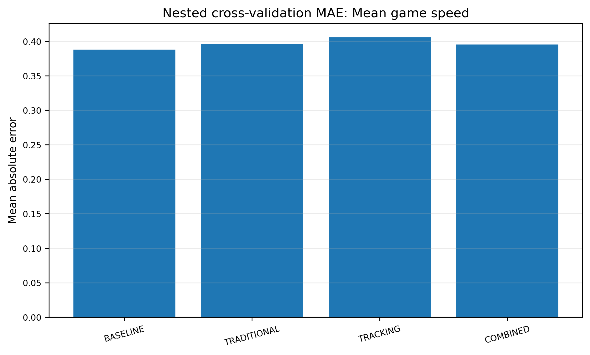

*Out-of-fold mean absolute error for the baseline, traditional Combine, tracking-derived and combined Ridge models. Evaluation uses 93 player-seasons from 54 receivers.*

### Nested cross-validation MAE: 95th-percentile game speed

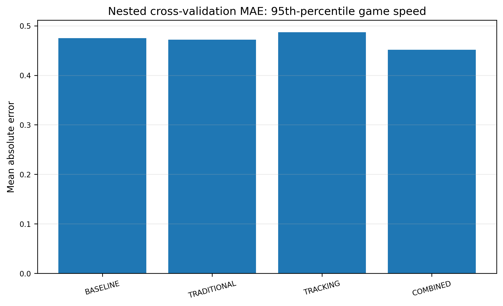

*Out-of-fold mean absolute error for the baseline, traditional Combine, tracking-derived and combined Ridge models. Evaluation uses 93 player-seasons from 54 receivers.*

### Nested cross-validation MAE: Peak game speed

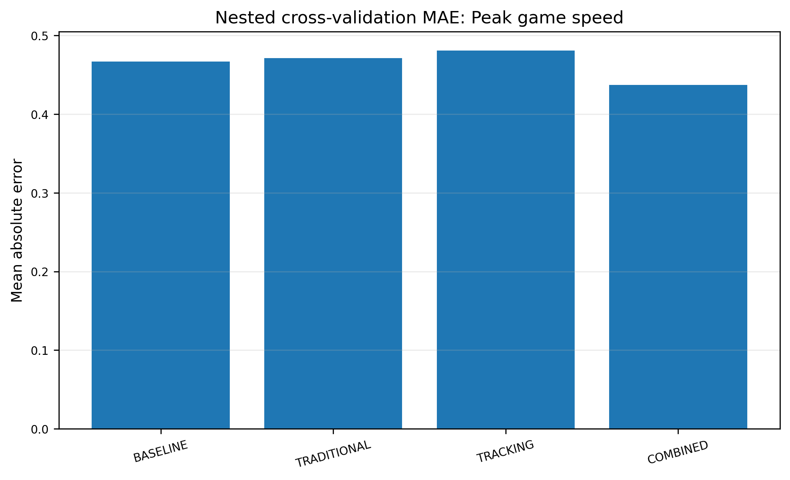

*Out-of-fold mean absolute error for the baseline, traditional Combine, tracking-derived and combined Ridge models. Evaluation uses 93 player-seasons from 54 receivers.*

### Nested cross-validation MAE across all outcomes

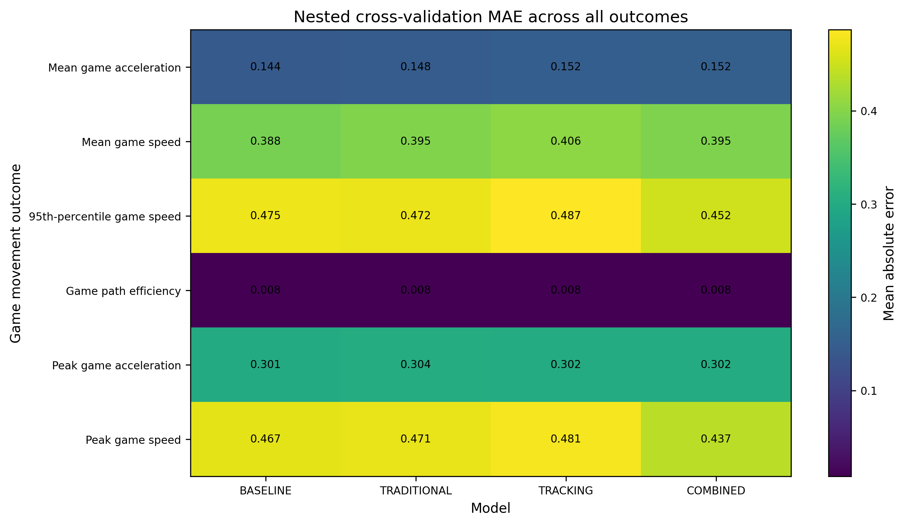

*Heatmap of out-of-fold MAE for six game movement outcomes and four model specifications. Outcomes have different measurement scales and should not be compared as though they shared a common unit.*

### Receiver-level bootstrap: 95th-percentile game speed

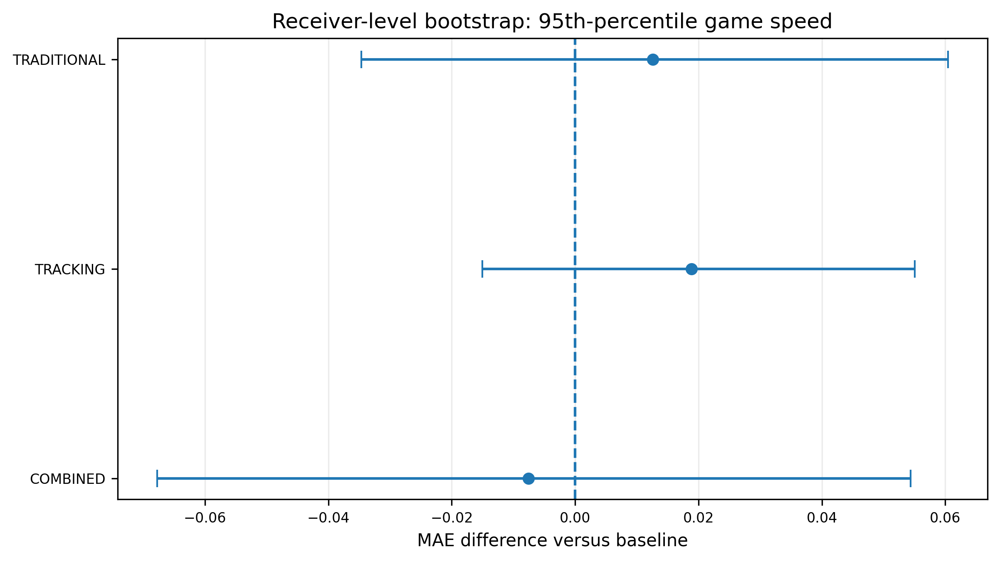

*Receiver-level bootstrap comparison of MAE differences versus baseline, using 5,000 replicates and fold-stratified resampling. Negative differences favour the evaluated model. Intervals crossing zero do not establish a reliable improvement.*

### Receiver-level bootstrap: Peak game speed

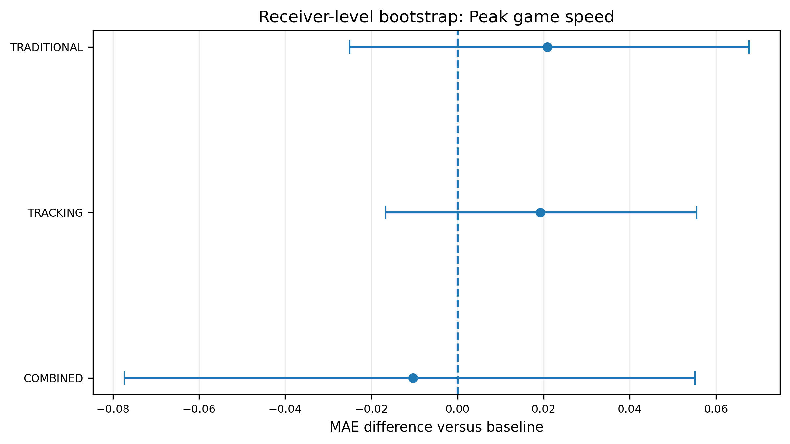

*Receiver-level bootstrap comparison of MAE differences versus baseline, using 5,000 replicates and fold-stratified resampling. Negative differences favour the evaluated model. Intervals crossing zero do not establish a reliable improvement.*

### LOCO performance: Mean game speed

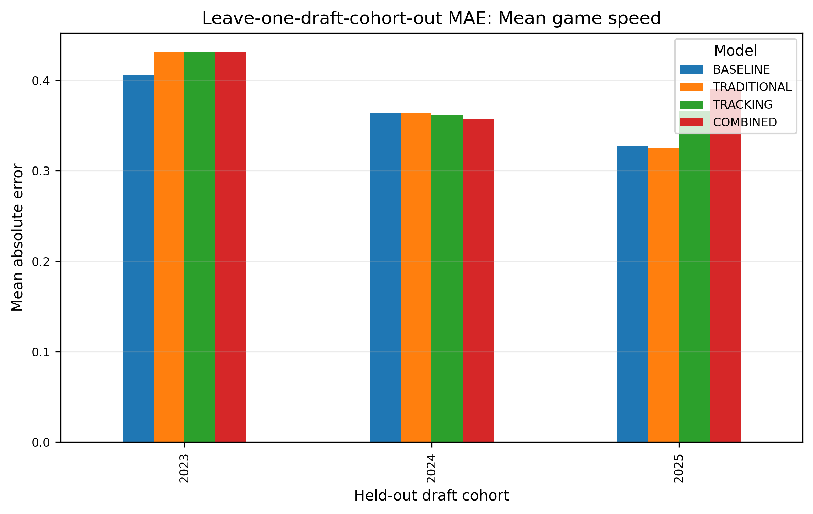

*Mean absolute error when an entire draft cohort is held out. Cohort sample sizes are unequal; these estimates are cohort-specific and should not be interpreted as definitive future-season generalization.*

### LOCO performance: 95th-percentile game speed

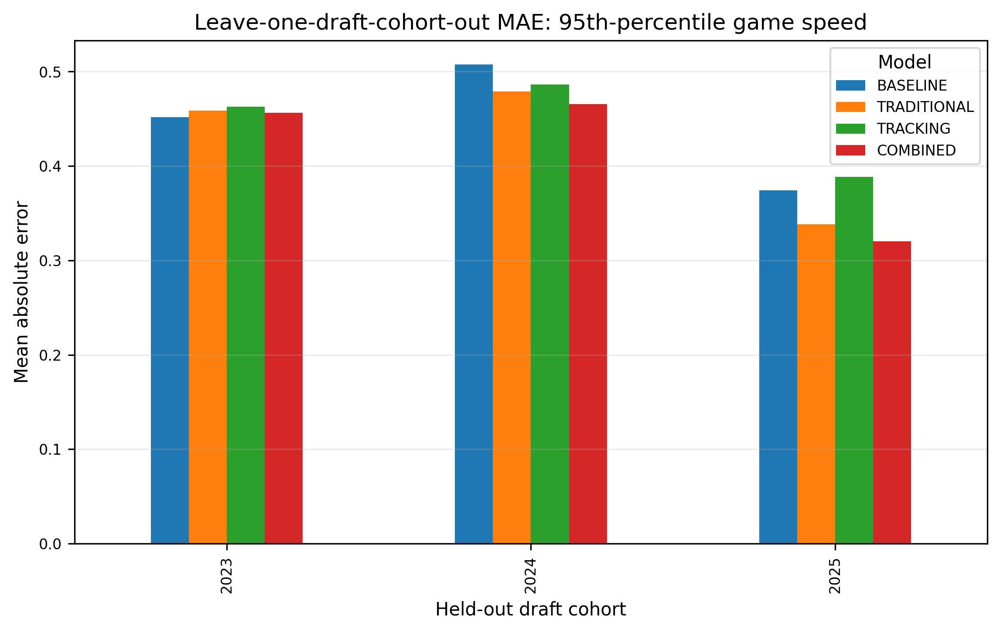

*Mean absolute error when an entire draft cohort is held out. Cohort sample sizes are unequal; these estimates are cohort-specific and should not be interpreted as definitive future-season generalization.*

### LOCO performance: Peak game speed

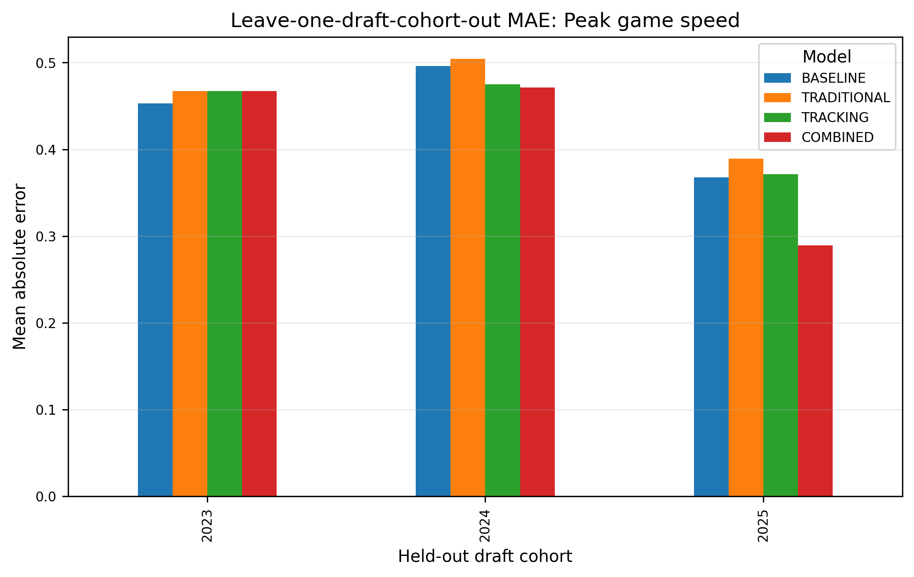

*Mean absolute error when an entire draft cohort is held out. Cohort sample sizes are unequal; these estimates are cohort-specific and should not be interpreted as definitive future-season generalization.*

### Univariate Combine-to-game movement associations

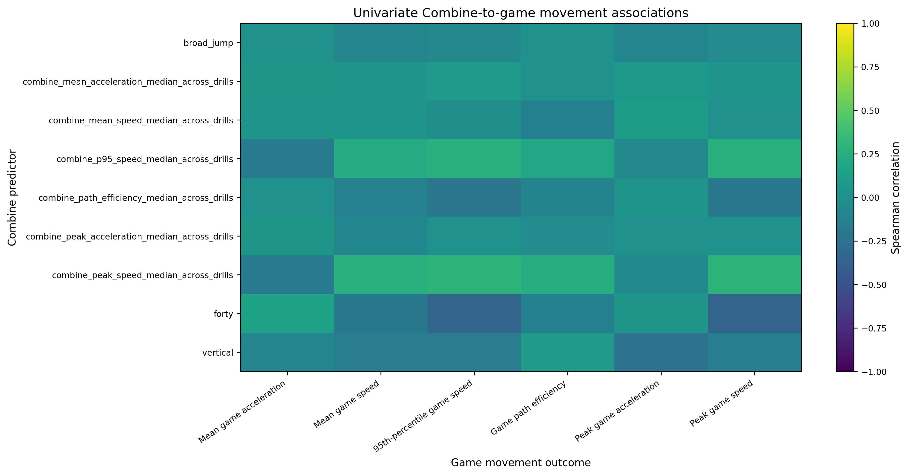

*Spearman rank correlations between nine Combine predictors and six game movement outcomes. These are univariate associations and do not represent adjusted independent effects or causality.*

### Tracking-feature ablation across game speed outcomes

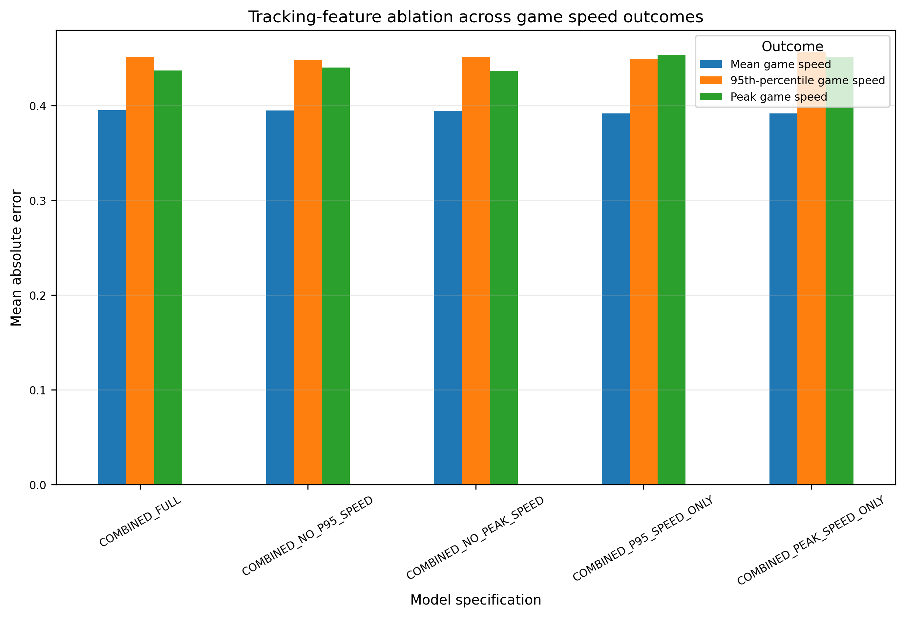

*Comparison of full and ablated tracking-feature specifications across mean, P95 and peak game speed. The results are descriptive and do not establish that an individual feature causes improved prediction.*

### Analysis sample size across receiver-play thresholds

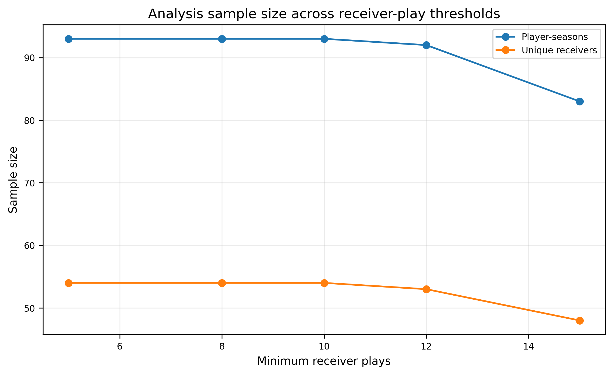

*Eligible player-season and receiver counts across minimum receiver-play thresholds of 5, 8, 10, 12 and 15. The threshold-10 sample contains 93 player-seasons and 54 receivers.*

---

# 11. Further research

Future work should investigate:

1. Larger receiver cohorts and additional NFL seasons.
2. More detailed route-specific movement outcomes.
3. Separation of acceleration magnitude and directional braking where measurement definitions permit.
4. Temporal and spatial route-phase features.
5. External validation on future cohorts.
6. Comparison with alternative regularized and nonlinear models under the same leakage-safe validation design.
7. Whether tracking-derived features improve decisions in a defined scouting or player-development task.

These are proposed extensions, not findings established by the current analysis.

---

# 12. Research integrity statement

This report distinguishes marginal association, out-of-fold predictive performance and uncertainty.

It does not claim causal effects. It does not claim that a favourable point estimate establishes a reliable model improvement. It preserves the frozen analysis sample and validated model outputs.

**End of report.**
