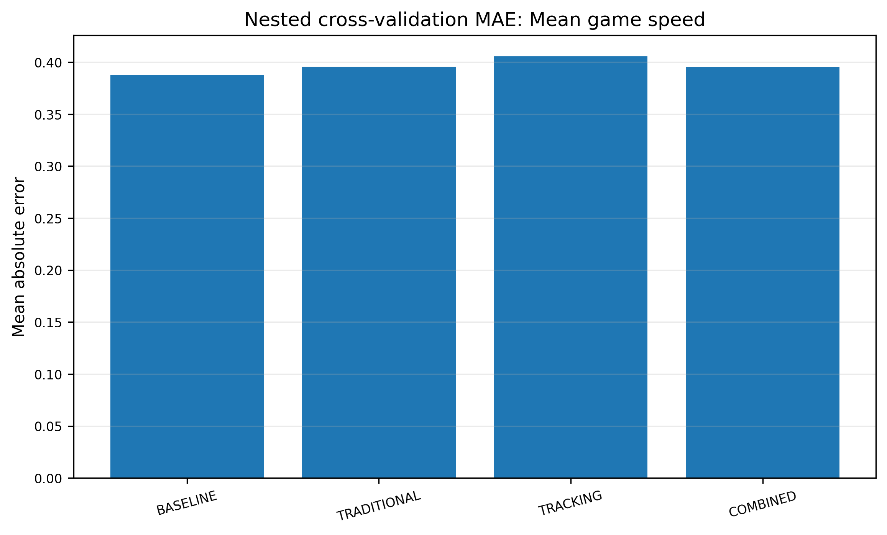
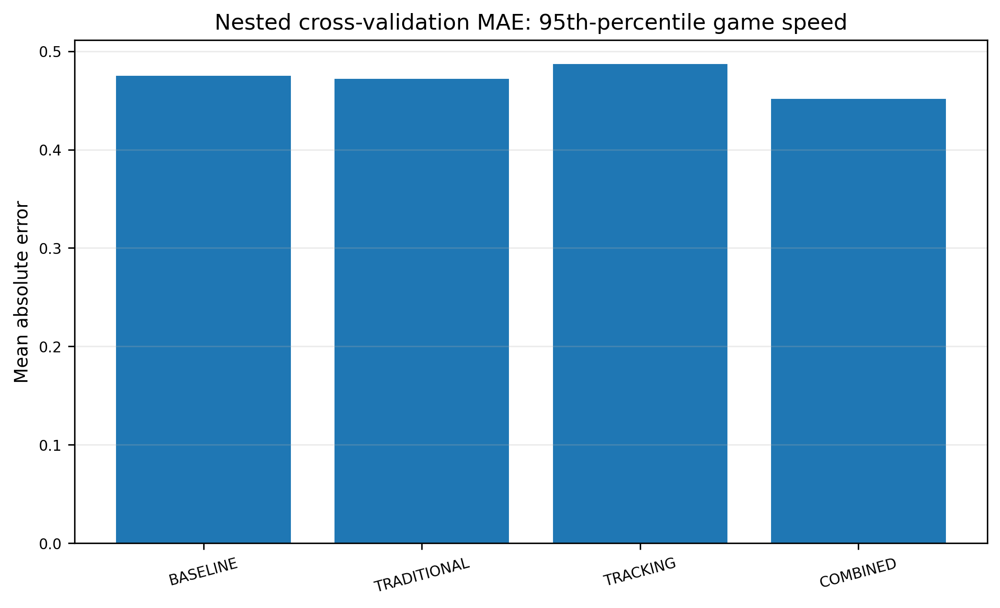
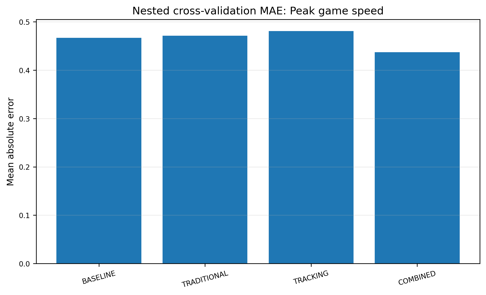
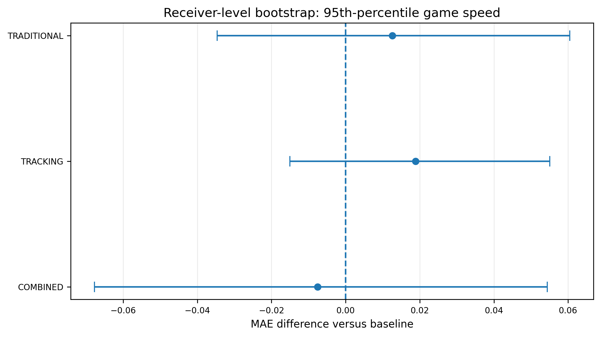
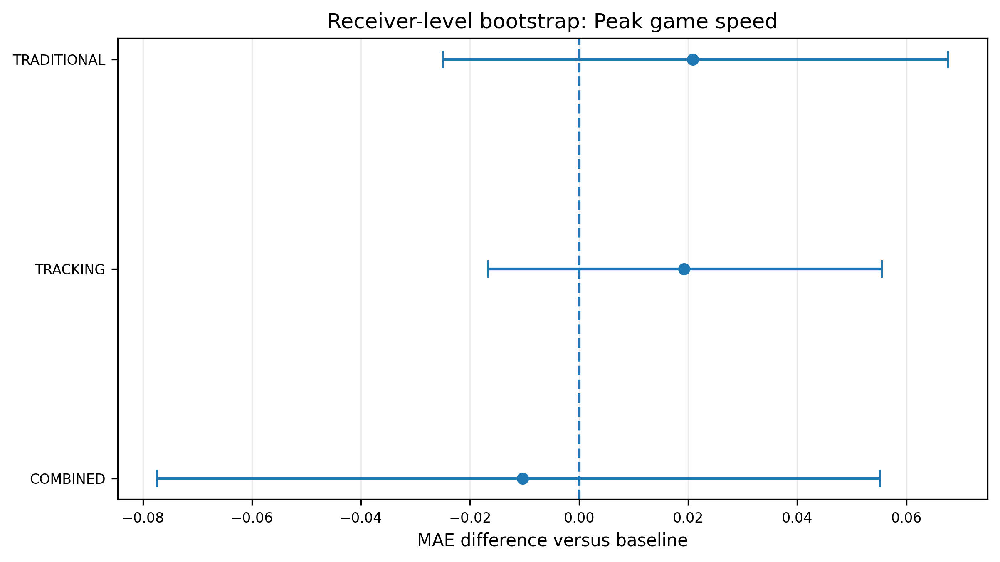
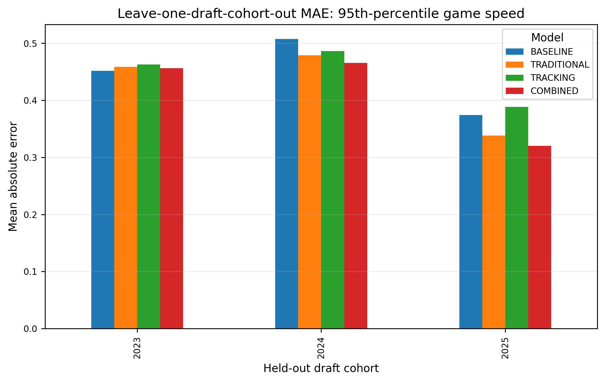
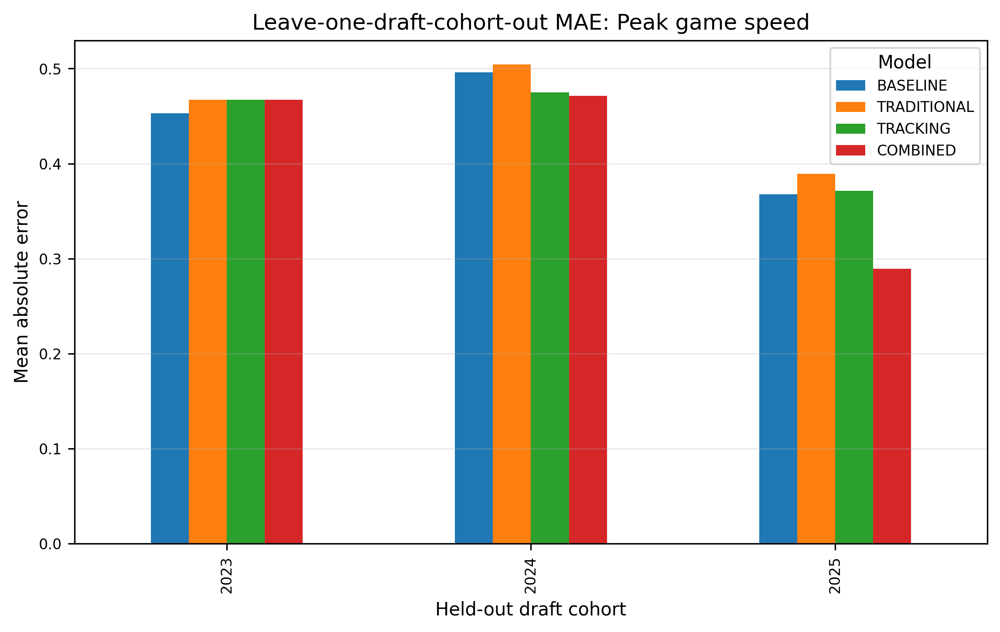
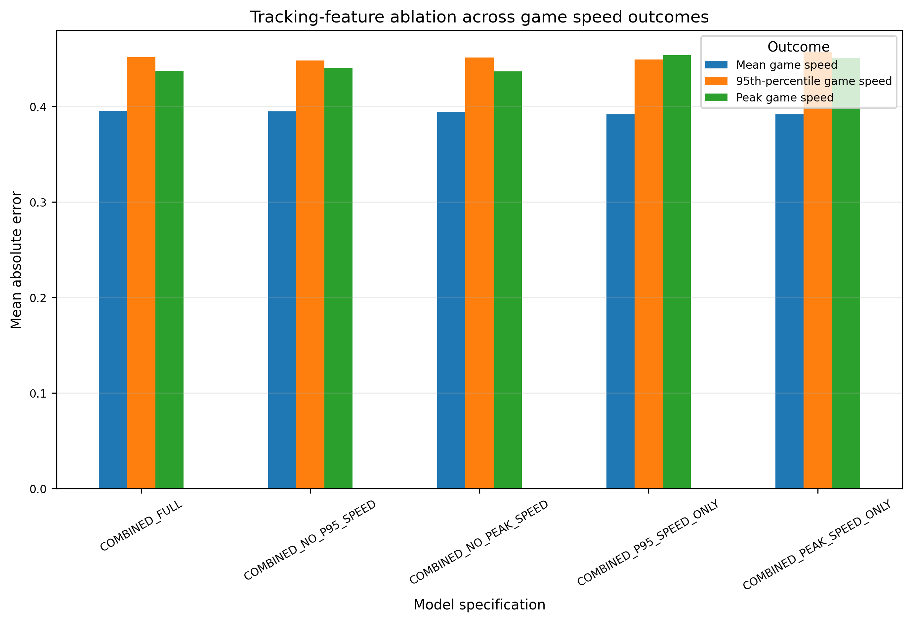

# Beyond the 40-Yard Dash: Do Combine Movement Mechanics Translate to NFL Receiver Performance?

**WR-MovementIQ | NFL Big Data Bowl 2027**

## The football question

The 40-yard dash measures straight-line speed. But NFL receivers must also accelerate, redirect, maintain speed through routes and move effectively in live plays.

The NFL Combine's 10 Hz sensor tracking creates an opportunity to study these movement characteristics in greater detail. We ask a focused question:

**Do movement characteristics recorded during receiver-specific Combine drills provide useful information about regular-season NFL receiver movement beyond traditional Combine measurements?**

We focus on wide receivers and slot receivers rather than attempting to model every position group.

## What we measured

We linked Combine drill tracking with regular-season NFL player tracking and player/play information.

Traditional Combine predictors were the 40-yard dash, vertical jump and broad jump.

Tracking-derived Combine predictors summarized speed, peak speed, 95th-percentile speed, acceleration and path efficiency across receiver drill attempts.

In-game outcomes summarized mean speed, peak speed, 95th-percentile speed, acceleration and path efficiency at the player-season level.

These are movement outcomes, not direct measures of receiving ability, route-running quality or overall player value.

The final core modeling sample contained **93 player-season observations from 54 receivers**. We retained complete cases for the primary predictors and outcomes rather than imputing missing Combine measurements.

## How we tested the relationship

We compared four model specifications:

- An intercept-only baseline.
- Traditional Combine measurements.
- Tracking-derived Combine movement features.
- A combined traditional and tracking-derived specification.

We used Ridge regression with standardized predictors. Hyperparameters were selected inside receiver-grouped inner cross-validation.

The outer evaluation used five-fold GroupKFold validation, grouping by receiver so that the same receiver could not appear in both training and test sets within a fold.

We also conducted leave-one-draft-cohort-out validation, withholding the 2023, 2024 and 2025 draft cohorts in turn.

For selected speed outcomes, we used 5,000 fold-stratified receiver-level bootstrap replicates to quantify uncertainty in paired MAE differences. Negative differences favour the evaluated model over the baseline.

## What we found

### 1. Traditional speed remains informative

The 40-yard dash had negative Spearman associations with in-game mean speed (rho = -0.193), peak speed (rho = -0.366) and 95th-percentile speed (rho = -0.355). Faster dash times therefore tended to correspond to higher in-game speed summaries, particularly peak and upper-tail speed.

This supports the 40-yard dash as a useful athletic benchmark, but not as a complete description of receiver movement. These are univariate associations, not evidence of independent predictive effects.

### 2. Combine tracking contains additional movement signal

Combine peak speed was positively associated with in-game P95 speed (rho = 0.293) and peak speed (rho = 0.290).

These are marginal associations. They do not establish that tracking-derived features provide independent predictive value after accounting for traditional tests.

### 3. Incremental predictive improvement remains uncertain

For P95 game speed, the combined model's receiver-level MAE difference against baseline was -0.0075, with a 95% receiver-level, fold-stratified bootstrap interval of [-0.0678, 0.0544].

For peak game speed, the corresponding difference was -0.0103, with a 95% interval of [-0.0774, 0.0552].

Negative differences favour the combined model. Both intervals include zero. The combined model has favourable point estimates, but the available evidence does not establish a reliable improvement in absolute predictive accuracy.

### 4. Performance must be tested across draft cohorts

We evaluated models by withholding each draft cohort. Cohort test sizes were unequal, and the 2025 held-out sample was particularly small.

The cohort results are therefore useful generalization diagnostics, not proof that the model will generalize to future NFL prospects.

### 5. More movement features do not automatically mean better prediction

Combine tracking-derived peak speed and 95th-percentile speed are strongly correlated (Spearman rho = 0.970). This overlap makes it difficult to distinguish their independent contributions. Ridge coefficient estimates also vary across validation folds, so individual coefficients should not be interpreted as stable measures of football importance.

Feature ablation and coefficient-stability analyses reinforce the need to evaluate the complete model out of sample rather than selecting a feature because it has an attractive individual association.

**Sample-eligibility sensitivity.** At minimum-play thresholds of 5, 8 and 10, the complete-case sample retained 93 player-seasons from 54 receivers. At 12 plays, it decreased to 92 player-seasons from 53 receivers. At 15 plays, it decreased to 83 player-seasons from 48 receivers. These results describe sample sensitivity; they do not establish that model performance is invariant across thresholds.

## What this means for football

The findings support using Combine tracking as a **movement diagnostic**, not as a stand-alone draft ranking system.

For scouts and player-development staff, tracking-derived drill summaries may help describe how a receiver moves beyond a single sprint time. They can motivate more specific questions about speed maintenance, acceleration and movement efficiency.

However, our results do not justify replacing traditional Combine measurements or making player-selection decisions from this model. The incremental predictive benefit remains uncertain.

The next practical step is to validate route-phase and drill-specific movement traits on larger receiver cohorts and future seasons.

## Limitations

The core sample is limited to 54 receivers and 93 player-seasons. Complete-case selection may affect representativeness. Some predictors are highly correlated, model coefficients vary across folds, and held-out cohort sizes are unequal.

The study is observational. It identifies associations and predictive performance, not causal effects. Game movement summaries also do not capture the full context of route assignments, coverage, quarterback decisions or receiving outcomes.

## Conclusion

Combine sensor tracking provides a richer description of receiver movement than traditional test results alone. Our analysis finds modest associations between some Combine movement summaries and selected in-game speed outcomes.

But the central test is incremental prediction: the current evidence does not demonstrate a consistent, reliable improvement from adding tracking-derived features.

That is the practical conclusion: **use movement tracking to deepen receiver evaluation, but demand stronger external validation before treating it as a predictive scouting advantage.**

*WR-MovementIQ — NFL Big Data Bowl 2027*
